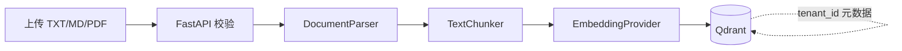
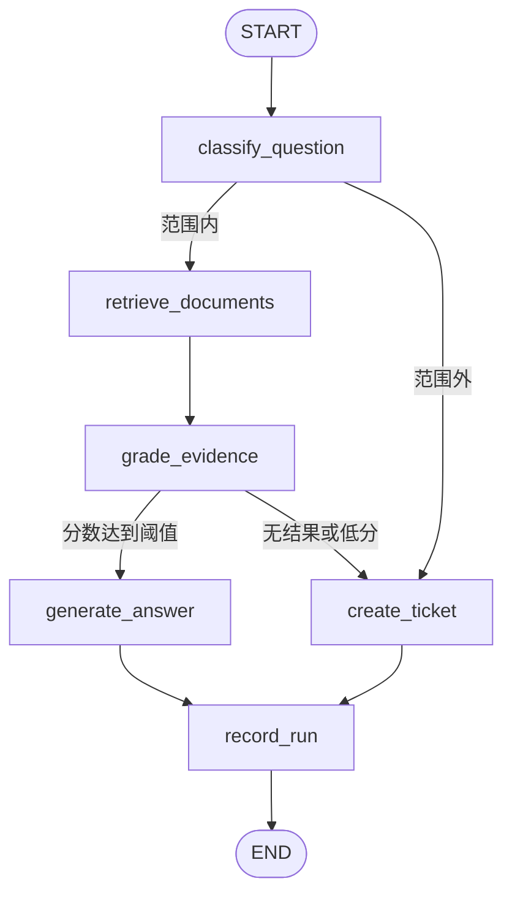
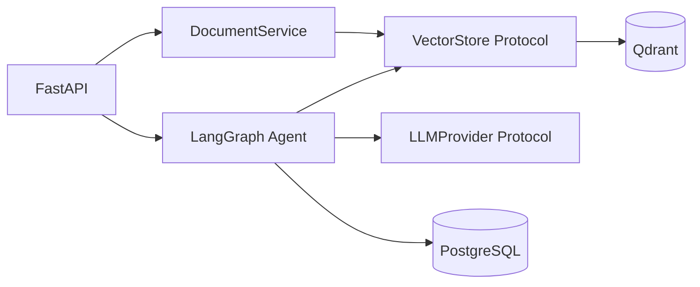

# 架构与数据流

## 文档导入

导入过程只负责建立可检索知识。文档 ID、来源名称、块序号、文本和 tenant_id 一起保存。扫描版 PDF 没有可提取文本时返回 422。

## Agent 问答

`generate_answer` 只能使用 Qdrant 返回的片段。引用信息由服务端直接从检索结果构造，不要求模型自己生成可靠的文件名或分数。

## 服务边界

测试使用内存 VectorStore、SQLite 和 DeterministicProvider；部署使用 Qdrant、PostgreSQL，并可选 OpenAIProvider。这些实现共享相同接口，所以业务流程不需要为测试写特殊分支。

## 安全边界

- 所有检索由服务端追加 tenant_id 过滤。
- API Key只从环境变量读取。
- 上传大小和扩展名受到限制。
- 数据库写入在一次请求事务中提交或回滚。
- 错误响应不返回堆栈或连接信息。
- 当前项目没有认证；生产版必须从认证身份取得 tenant_id。
